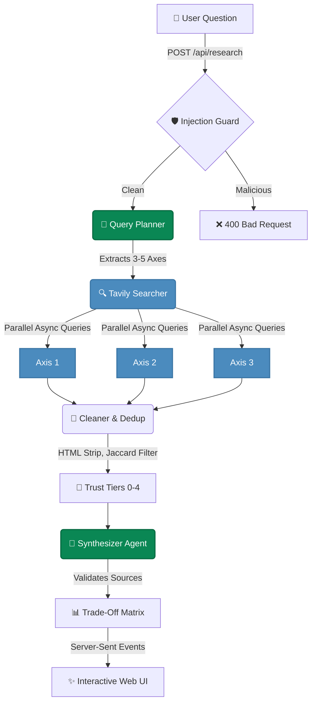

<div align="center">

# 🚀 ArchDecision AI

**Compare technologies with sourced, verifiable evidence.**

[](https://python.org)
[](https://fastapi.tiangolo.com)
[](https://console.nebius.ai)
[](https://tavily.com)
[](#-test-coverage)
[](LICENSE)

An autonomous research agent that produces **Architecture Trade-Off Matrices** for software engineers. Every claim is backed by a real source. Every conflict is flagged. Nothing is fabricated.

Built for the **[ODSC AI x Nebius Hackathon](https://odsc.com)**.

[Watch the Demo Video 🎥](#) <!-- Replace # with your YouTube/Loom link later -->

</div>

<br>

> **Note:** To see the pipeline in action, [watch the 60-second demo](#).

<details open>
<summary><b>📸 Sneak Peek (Click to toggle)</b></summary>
<br>

| 🔍 Live Streaming Pipeline | 📊 Interactive Matrix |
|:---:|:---:|
|  |  |
| **🛡️ Prompt Injection Defense** | **⚠️ Conflict Detection & Trace** |
|  |  |

</details>

---

## ✨ Why ArchDecision?

Software engineers waste hours comparing technologies across scattered blog posts, outdated benchmarks, and vendor marketing pages. ArchDecision does the heavy lifting:

*   **Ask** a comparison question (e.g., "PostgreSQL vs MongoDB for real-time analytics")
*   **Watch** the agent plan axes, search evidence, clean sources, and synthesize a matrix in ~30 seconds.
*   **Decide** using visual confidence badges, inline citations, and conflict warnings.

❌ No hallucinated benchmarks.  
❌ No invented URLs.  
✅ Every single cell links directly to the source that proved it.

---

## 🧠 Interactive Architecture

ArchDecision uses a multi-agent pipeline orchestrated with asynchronous Python.



### 🥇 The Trust Tier System
The Cleaner automatically ranks sources by domain credibility before they ever reach the final LLM synthesis:

| Tier | Trust Level | Source Types | Examples |
|:---:|---|---|---|
| **0** | 🟢 **Highest** | Official Documentation | `postgresql.org`, `redis.io` |
| **1** | 🟢 **High** | Cloud Vendors / Tech Blogs | `aws.amazon.com`, `netflixtechblog.com` |
| **2** | 🟡 **Medium** | Reputable Community | `stackoverflow.com`, `github.com` |
| **3** | 🟠 **Low** | General Blogs | `medium.com`, unknown domains |
| **4** | 🔴 **Untrusted** | SEO Farms / Aggregators | `tutorialspoint.com`, `w3schools.com` |

---

## 🏆 Hackathon Rubric Alignment

| Criterion | Weight | How ArchDecision Scores |
|---|:---:|---|
| **Sourced & Verifiable** | `30%` | Every matrix cell cites an exact URL. Assigns Confidence (H/M/L) and Tags (FACT/INFERENCE). Flags conflicting credible sources. |
| **End-to-End Pipeline** | `25%` | Full path: Text Input ➡️ 5-Step Pipeline ➡️ Structured Matrix ➡️ SSE UI. Tested by 65 automated pytest assertions. |
| **Usefulness** | `20%` | Solves the "tab fatigue" problem for devs. Adapts axes dynamically (no fixed templates). Tracks exact token cost (~$0.002/query). |
| **Agent Design** | `15%` | Multi-step architecture (Plan ➡️ Search ➡️ Clean ➡️ Synthesize). Includes model fallbacks, backoff retries, and injection defense. |
| **Token Factory + Tavily**| `10%` | Uses `Qwen3-235B` (Primary) & `Gemma-3-27B` (Fallback) via Nebius. Uses Tavily for deep web extraction. |

---

## 🛠️ Quick Start

<details>
<summary><b>1. Prerequisites (Click to expand)</b></summary>

*   **Python 3.12+**
*   A **[Nebius Token Factory](https://console.nebius.ai)** API key (free trial credits work perfectly).
*   A **[Tavily](https://tavily.com)** API key (1,000 free searches/month).
</details>

<details open>
<summary><b>2. Installation & Setup</b></summary>

```bash
# Clone the repository
git clone https://github.com/Umaima-Manzoor/ArchDecision-AI.git
cd ArchDecision-AI

# Create and activate virtual environment
python -m venv .venv
.venv\Scripts\activate        # Windows
# source .venv/bin/activate   # macOS/Linux

# Install dependencies
pip install -r requirements.txt

# Setup environment variables
cp .env.example .env
```
👉 *Open `.env` and paste your `NEBIUS_API_KEY` and `TAVILY_API_KEY`.*
</details>

<details open>
<summary><b>3. Run the App</b></summary>

```bash
uvicorn app.main:app --reload --port 8000
```
Open **[http://localhost:8000](http://localhost:8000)** to use the UI!
</details>

---

## 💸 Cost Efficiency

By filtering noise in the `Cleaner` layer and using strict prompts, token waste is minimized. 

| Model | Input Cost | Output Cost | Typical Query |
|---|---|---|---|
| **Qwen3-235B-A22B** | $0.20 / 1M | $0.60 / 1M | ~7,000 tokens ≈ **$0.002** |
| **Gemma-3-27B** *(Fallback)* | $0.10 / 1M | $0.30 / 1M | ~7,000 tokens ≈ **$0.001** |

> *With the standard Nebius trial credits, you can run roughly **400 full comparisons** for free.*

---

## 🧪 Test Coverage

ArchDecision includes a robust test suite covering schema validation, HTML cleaning, Jaccard deduplication, prompt injection, and End-to-End integration.

```bash
pip install -r requirements-dev.txt
python -m pytest tests/ -v
```
<kbd>65 passed in ~10.13s</kbd>

---

## 📚 API Reference

<details>
<summary><b><code>POST /api/research</code> (JSON Response)</b></summary>

Run the full pipeline synchronously.

**Request:**
```json
{ "question": "Compare DuckDB vs ClickHouse for embedded analytics" }
```

**Response Extract:**
```json
{
  "matrix": {
    "technology_a": "DuckDB",
    "cells": [
      {
        "axis": "Query Performance",
        "claim": "DuckDB processes analytical queries on local data in milliseconds...",
        "source_url": "https://duckdb.org/why_duckdb",
        "confidence": "H"
      }
    ]
  },
  "latency_seconds": 28.4,
  "token_usage": {
    "total_tokens": 7000,
    "estimated_cost_usd": 0.0021
  }
}
```
</details>

<details>
<summary><b><code>GET /api/research/stream</code> (SSE Streaming)</b></summary>

Same pipeline, but streams Server-Sent Events for live UI updates.

```text
GET /api/research/stream?question=PostgreSQL+vs+MongoDB
```
</details>

---

<div align="center">
  <p>Built with ❤️ for the ODSC Hackathon</p>
  <p>Released under the <a href="LICENSE">MIT License</a>.</p>
</div>